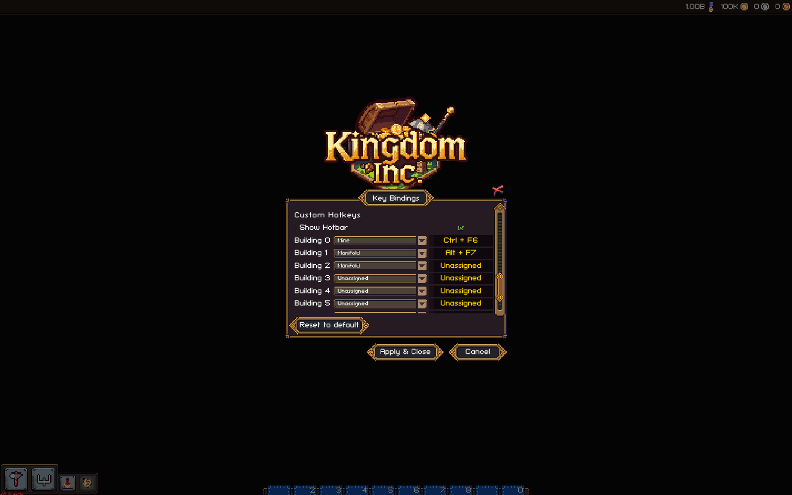

# Hotkey Customizer

Key combinations for vanilla shortcuts, ten configurable building shortcuts, and a vertical building hotbar for Kingdom Inc. Entries are numbered 0-9, and every key and building starts **Unassigned**. Installing this plugin does not change any workspace shortcut or other existing game binding.

[Published releases](https://github.com/urakkaamyx/KingdomInc_HotkeyCustomizer/releases) · [Nexus Mods](https://www.nexusmods.com/kingdominc/mods/16)



## Use

1. Open **Options > Key Bindings** from the main menu or pause menu.
2. To change a vanilla shortcut, click its existing key field. For a building shortcut, scroll down to **Custom Hotkeys**, choose a building in the left dropdown for **Building 0-9**, then click the key field on the right.
3. Hold the desired modifiers, then press the final key. Ctrl, Alt, Shift and Windows/Meta modifiers can be combined, for example **Ctrl + Shift + 1**. Left and right modifiers work interchangeably.
4. Repeat for other shortcuts as needed. The building key fields use the vanilla font, color and hover style.
5. Click **Apply**. **Cancel** discards pending edits.

The **Custom Hotkeys** section also includes **Show Hotbar**, enabled by default. The vertical bar peeks out from the right edge during gameplay. Hover to reveal it; move away to tuck it back. Each slot has a black background with the assigned building's native icon and a small shortcut label. Building names appear only in hover tooltips. Click an icon to open that building's normal placement preview, including when its keyboard shortcut is unassigned. Locked buildings are dimmed and remain subject to research and cost checks. Empty slots have no building icon.

Uncheck **Show Hotbar** and apply to hide the bar; keyboard shortcuts continue working. The checkbox follows the same Apply/Cancel behavior as other settings. Reset restores the checkbox to enabled in the pending form. The bar scales to fit the available UI height and hides behind pause menus and alerts.

Vanilla bindings use the game's normal actions and can now capture combinations as well as single keys. Existing assignments stay in place until you change and apply them. Only the combination you choose triggers the reassigned action; its plain key and extra modifiers do not match.

While assigning a key, **Backspace** or **Delete** clears it; **Escape** cancels capture. **Reset** clears all ten building entries alongside the game's normal binding reset, and takes effect when you click Apply.

Entry numbers are labels, not default key assignments. Choose keys that do not overlap existing shortcuts. If two entries use the same shortcut, the lowest-numbered entry takes priority. Existing game actions keep working, including any bindings that overlap the shortcut you choose.

A building hotkey opens the normal placement preview. Place and cancel the building as usual. Shortcuts respect research unlocks and purchase costs. Locked buildings remain selectable in the dropdown so you can plan assignments; they do nothing until researched. Assignments to unavailable companion buildings are preserved and shown as unavailable. Hotkeys are inactive in the pause menu, text fields, alerts, popup menus and tools that would conflict with placement.

## Requirements and installation

Requires the Windows Mono version of Kingdom Inc., BepInEx 5 and its bundled Harmony library. Tested with Kingdom Inc. Release v1.0.12, Unity 6000.3.27f2 and BepInEx 5.4.23.6. Detailed test evidence is recorded in `Releases/RELEASE_VERIFICATION.json` in the source project. The release ZIP contains this plugin and instructions; it does not bundle the game or BepInEx. Obtain the BepInEx 5 Windows x64 loader from https://github.com/BepInEx/BepInEx/releases if needed.

Close the game. Extract the ZIP into the Kingdom Inc. installation directory, preserving this path:

`BepInEx/plugins/HotkeyCustomizer/HotkeyCustomizer.dll`

For an update, replace only that plugin DLL while the game is closed. Settings are stored separately at `BepInEx/config/urakka.kingdominc.hotkeycustomizer.cfg` and persist across updates and across kingdoms. No save migration is needed.

To remove, close the game and delete the `BepInEx/plugins/HotkeyCustomizer` folder. Optionally delete its configuration file to discard assignments. The plugin does not add save data. Vanilla combinations require this plugin; removing it leaves their final keys as ordinary vanilla bindings. Other native bindings stay as assigned. Use the game's Reset to default option if you want to restore defaults. Mod-manager deployment has not been tested; manual installation is supported.

## Build and verification

Keep this source project at `<KingdomInc>/_Mods/HotkeyCustomizer`, with the game and BepInEx assemblies available locally. A .NET SDK supporting .NET Standard 2.1 is required.

```powershell
dotnet build .\HotkeyCustomizer.csproj -c Release
.\verify-isolated.ps1
.\verify-isolated.ps1 -WithExistingPlugins
.\Tools\package.ps1
.\install.ps1
```

`verify-isolated.ps1` creates a separate local runtime, starts a disposable kingdom, blocks save writes and achievements, and redirects the key-binding screen's input preferences to memory. It checks blank defaults, UI, Apply/Cancel/Reset, configuration persistence, modifier capture, vanilla workspace/menu combinations, single-key and cleared vanilla bindings, portable native preferences, placement and research/cost/input guards. Hotbar checks cover the custom section and checkbox, persistence, hidden-bar keyboard use, reveal and retreat, building icons and hover titles, click placement and locked buildings. It never loads a normal saved kingdom. The companion run copies installed plugins into that isolated runtime. Verification output is local and excluded from the player package.

The install script checks that the game is closed before replacing an existing DLL. `-StageForNextLaunch` permits a first installation while the game is running; the game must restart to load it.

## Credits

Created by Urakka. Uses BepInEx, Harmony and the game's native fonts and UI templates at runtime. No extracted game artwork or game assemblies are distributed. Kingdom Inc. and its assets belong to their respective owners.

Generative AI was used for code, documentation and promotional thumbnail artwork. The gameplay screenshot shows the running mod. The thumbnail follows the shared Kingdom Inc. mod artwork template; it is promotional artwork and is not part of the in-game plugin.
